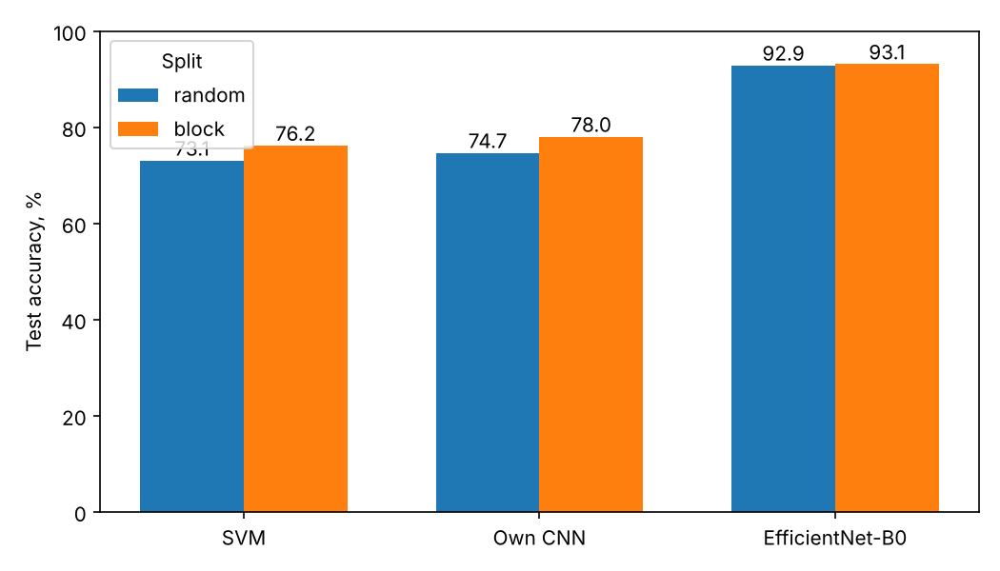
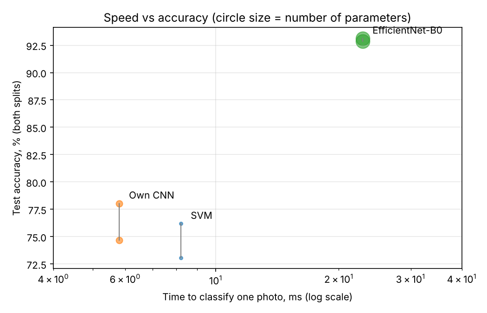
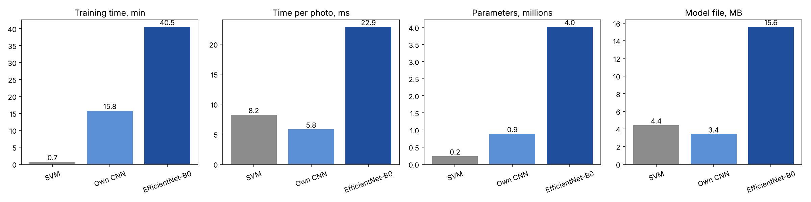
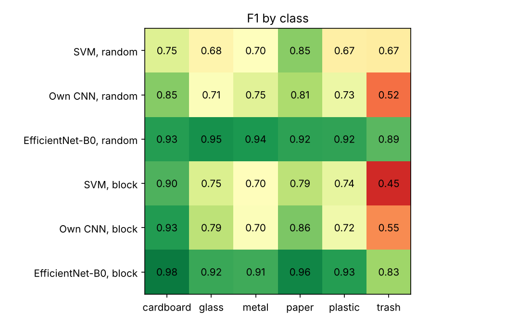
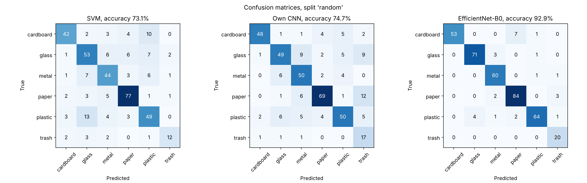
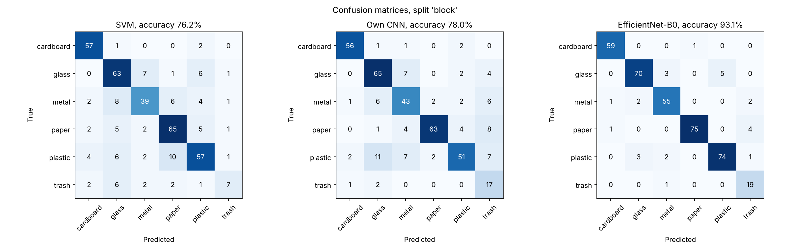
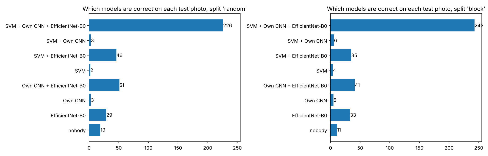
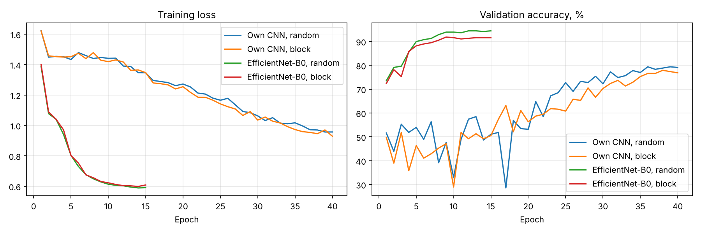
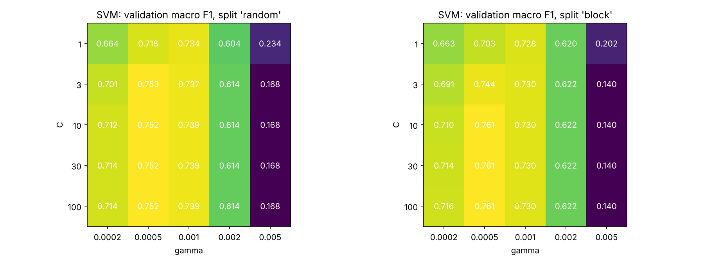
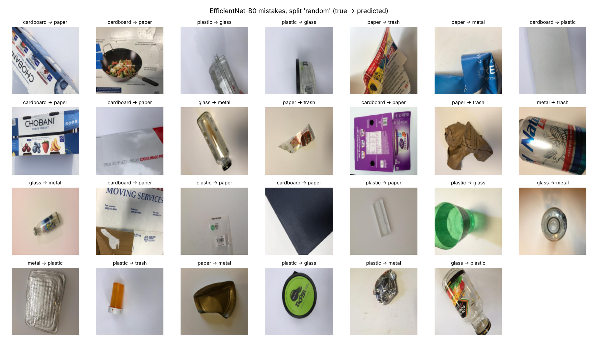

# Results

## Main metrics

| Split | Model | Test accuracy | Macro F1 | Val accuracy | Parameters | Training, min |
|---|---|---|---|---|---|---|
| random | SVM | 73.1% | 0.719 | 77.8% | 230,400 | 0.7 |
| random | Own CNN | 74.7% | 0.728 | 79.4% | 886,406 | 15.8 |
| random | EfficientNet-B0 | 92.9% | 0.924 | 94.4% | 4,015,234 | 40.5 |
| block | SVM | 76.2% | 0.721 | 76.6% | 229,800 | 0.7 |
| block | Own CNN | 78.0% | 0.760 | 77.9% | 886,406 | 16.4 |
| block | EfficientNet-B0 | 93.1% | 0.920 | 91.6% | 4,015,234 | 40.2 |

## Speed and size

| Model | Accuracy (random) | Training, min | ms per image | Images per second | Parameters | File, MB |
|---|---|---|---|---|---|---|
| SVM | 73.1% | 0.7 | 8.2 | 122 | 230,400 | 4.4 |
| Own CNN | 74.7% | 15.8 | 5.8 | 172 | 886,406 | 3.4 |
| EfficientNet-B0 | 92.9% | 40.5 | 22.9 | 44 | 4,015,234 | 15.6 |

## F1 by class

| Split | Model | cardboard | glass | metal | paper | plastic | trash |
|---|---|---|---|---|---|---|---|
| random | SVM | 0.750 | 0.679 | 0.698 | 0.846 | 0.671 | 0.667 |
| random | Own CNN | 0.850 | 0.705 | 0.746 | 0.812 | 0.730 | 0.523 |
| random | EfficientNet-B0 | 0.930 | 0.947 | 0.938 | 0.923 | 0.921 | 0.889 |
| block | SVM | 0.898 | 0.754 | 0.696 | 0.793 | 0.735 | 0.452 |
| block | Own CNN | 0.933 | 0.793 | 0.705 | 0.857 | 0.723 | 0.548 |
| block | EfficientNet-B0 | 0.975 | 0.915 | 0.909 | 0.962 | 0.931 | 0.826 |

## Which models are correct

| Who is correct | random | block |
|---|---|---|
| SVM + Own CNN + EfficientNet-B0 | 226 | 243 |
| SVM + Own CNN | 3 | 6 |
| SVM + EfficientNet-B0 | 46 | 35 |
| SVM | 2 | 4 |
| Own CNN + EfficientNet-B0 | 51 | 41 |
| Own CNN | 3 | 5 |
| EfficientNet-B0 | 29 | 33 |
| nobody | 19 | 11 |

## Plots

